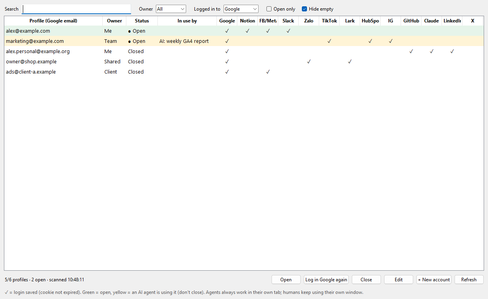
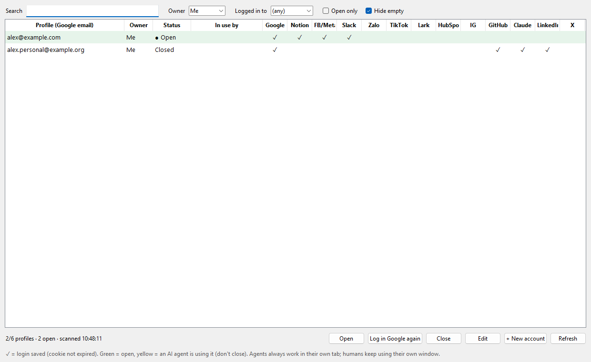

<p align="center"></p>

<h1 align="center">Chrome Profile Hub</h1>

<p align="center"><b>One table for all your logged-in Chrome profiles - shared by humans and AI agents.</b><br>
Log in once by hand (with 2FA). Let Claude, Codex, Cursor or any Playwright script reuse that login safely.</p>

<p align="center"></p>

## The problem

If you run many Google accounts (agency, marketing team, side businesses) **and** you use AI agents for browser work, you hit the same walls:

- **Google blocks sign-in** in the Chromium that Playwright launches ("This browser or app may not be secure").
- **Chrome DevTools MCP works but burns tokens**: every step sends the whole page tree to the model.
- **Logins get lost** across dozens of profiles: which profile has Notion? Which one is still logged in to Meta Ads? Whose phone has the 2FA?
- **Humans and agents collide**: the agent closes your window, or navigates the tab you were typing in.

## The idea

**1 Google account = 1 real Chrome profile = 1 fixed debugging port.**

- A human opens the profile from the hub, logs in once (password + 2FA). Cookies stay in that profile.
- An agent attaches to the **same real Chrome** over CDP (`connect_over_cdp`) - Google sees a normal browser, the agent drives it with cheap, text-only Playwright calls.
- The hub shows, for every profile: owner, open/closed, **who is using it right now (human or AI + task)**, and **which services are logged in** (Google, Notion, Facebook/Meta, Slack, Zalo, TikTok, Lark, HubSpot, Instagram, GitHub, Claude, LinkedIn, X, Shopee).
- Agents always work in **their own tab** and leave a **lease** (the row turns yellow) so nobody closes Chrome under them.

## Features

- Desktop table (Tkinter - nothing to install besides Python), English / Vietnamese UI
- Double-click to open a profile; right-click -> **Log in again** to any service (opens the right login page)
- **+ New account**: creates a dedicated profile + fixed port and opens the Google sign-in page
- Filter by owner, by service ("who is logged in to Notion?"), open only; sort by any column
- Login detection reads only cookie **names and expiry dates** - never cookie values, never decrypts anything
- Works with your existing profile folders (`scan_roots`, `pinned`, `index_files` in the config) - nothing is moved
- Multiple agent runs on the same profile are fine ("AI x2: task A; task B")
- Optional: also list the profiles of your **everyday Chrome** (`"everyday_chrome": true`) - open them and see their logins from the same table
- CLI + Python API for agents: `pick`, `open_chrome`, `agent_page`

<p align="center"> </p>

## Install (Windows)

```powershell
git clone https://github.com/CuongTranTVG/chrome-profile-hub.git
cd chrome-profile-hub
powershell -ExecutionPolicy Bypass -File install.ps1          # add -Lang vi for Vietnamese, -AllUsers for all users
```

Then open **Chrome Profile Hub** from the Start Menu. Edit `%APPDATA%\ChromeProfileHub\config.json` to point at the profile folders you already have.

Requirements: Windows 10/11 or Server 2019+, Python 3.10+, Google Chrome. (macOS/Linux: the core and CLI work, the installer is Windows-only.)

## Use it from an AI agent

```python
from playwright.sync_api import sync_playwright
from chrome_profile_hub import pick, open_chrome, agent_page

prof = pick("notion")                     # a profile already logged in to Notion
with sync_playwright() as p:
    browser, ctx = open_chrome(p, prof["key"], task="read Notion inbox")   # row turns yellow
    page = agent_page(ctx, "https://www.notion.so")                        # own tab, auto-closed
    print(page.inner_text("body")[:500])
    # never browser.close(): that would close the human's window
```

```bash
python -m chrome_profile_hub list --service notion        # who is logged in to Notion
python -m chrome_profile_hub pick facebook --owner Team    # JSON: key, email, port
python -m chrome_profile_hub open me@example.com https://ads.google.com
python -m chrome_profile_hub new new.account@example.com Team
```

Copy the rules in [docs/AGENTS.md](docs/AGENTS.md) into your `CLAUDE.md` / `AGENTS.md` so the agent behaves.

## Configuration

`%APPDATA%\ChromeProfileHub\config.json` (or set `CPH_CONFIG`). See [config.example.json](config.example.json).

| key | meaning |
|---|---|
| `lang` | `en` or `vi` |
| `agent_label` | label in the "In use by" column, e.g. `Claude` |
| `scan_roots` | folders whose sub-folders are Chrome user-data-dirs |
| `pinned` | profiles with a fixed port and name, e.g. your main work profile |
| `index_files` | JSON files `{key: {name, email, dir}}` if you keep your own index |
| `owners`, `owner_rules` | owner list and `["substring", "Owner"]` rules to guess owners |
| `data_dir` | where ports, notes, scan cache, leases and logs live |
| `everyday_chrome` | `true` to also list your normal Chrome profiles (human-only rows) |
| `remote_allow_origins` | leave empty; set `"*"` only if an old tool needs it |

## Everyday Chrome vs. hub profiles

Since Chrome 136, Chrome **refuses remote debugging on its default profile folder** (a protection against cookie-stealing malware).
So the profiles of your normal Chrome can be *listed and opened* by the hub (grey rows, "human only"), but an AI agent cannot attach to them.
To give an agent a login: **+ New account** -> a dedicated profile folder with its own port -> log in once by hand. Copying an existing
profile folder does not work: Chrome encrypts cookies per folder, so the copy arrives logged out.

## Security notes

- The debugging port listens on **127.0.0.1 only**. Anyone who can run code as your Windows user can drive those browsers - which is already true of your Chrome profile files. Do not run this on a shared account you don't trust.
- By default Chrome only accepts CDP clients **without** an `Origin` header (Playwright, scripts), so a web page cannot attach.
- The hub never reads cookie values or passwords and never sends anything over the network.
- Keep banking and other high-risk accounts out of agent-accessible profiles.

## How it compares

- **Playwright MCP / launch_persistent_context**: great for test sites; Google login is blocked in its Chromium.
- **Chrome DevTools MCP**: real Chrome, but every step is a full page snapshot (expensive) and there is no account inventory.
- **Anti-detect browsers** (multi-account tools with fake fingerprints): built for evading detection; risky for your real Google/Meta accounts. This project uses plain, unmodified Chrome.
- **Shared-browser MCP servers**: good tab isolation for agents, but no table for humans and no login inventory.

## License

MIT
